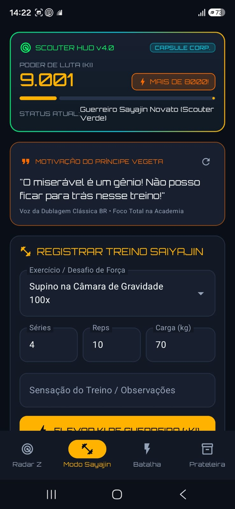
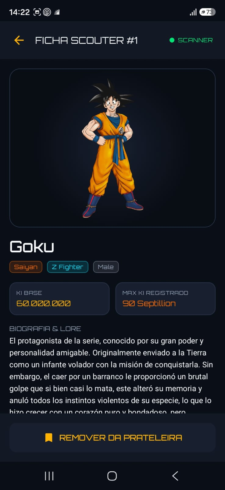
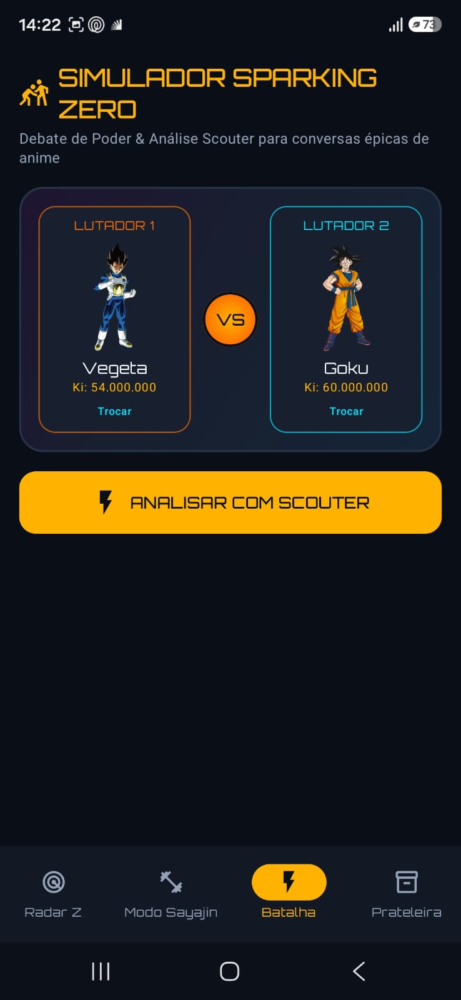
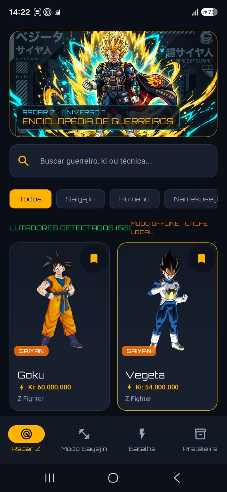
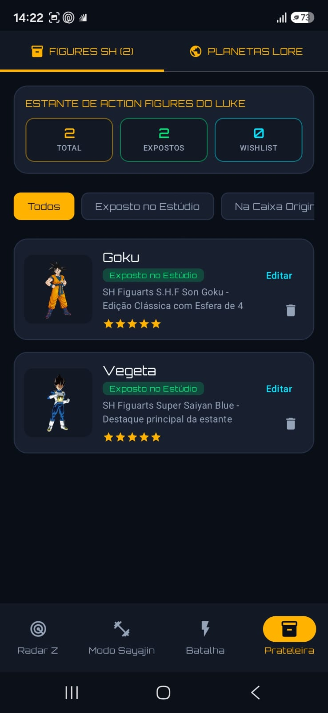

# Z-Scouter — Central Dragon Ball Z & Super

Aplicativo Android nativo desenvolvido em **Kotlin + Jetpack Compose** seguindo **Clean Architecture**, **MVVM (UDF)** e estratégia **Offline-First**, que transforma o universo de **Dragon Ball** em uma central interativa para fãs da franquia: enciclopédia de guerreiros e planetas via API REST, rastreador de treinos na academia com progressão de Ki (*Modo Saiyajin*), simulador de batalhas estilo *Sparking! ZERO* e estante pessoal de colecionáveis (*S.H. Figuarts*).

---

## 🎯 Persona Alvo

Desenvolvido sob medida para **Lucas "Luke" Silva** (28 anos, Designer Gráfico / Ilustrador Freelancer em São Paulo, SP):

- **Nostalgia & Atualidade:** Cresceu assistindo às sagas Freeza e Cell na TV aberta nos anos 2000 e acompanha os filmes e capítulos atuais (*Dragon Ball Super: Broly* e mangá).
- **Inspiração no Príncipe Vegeta:** Valoriza a jornada de redenção, a disciplina e frases clássicas da dublagem brasileira.
- **Estilo de Vida "Kame":** Treinos de musculação na pegada *Super Saiyajin* ouvindo trilha sonora épica da franquia.
- **Colecionador & Gamer:** Organização de miniaturas *S.H. Figuarts* no estúdio e debates de nível de poder para jogos como *Dragon Ball: Sparking! ZERO* e *FighterZ*.

---

## 🌐 API REST Utilizada

O app consome a **Dragon Ball API** pública e aberta (sem necessidade de chave de API ou OAuth):

- **Base URL:** `https://dragonball-api.com/api/`
- **Documentação Oficial:** `https://web.dragonball-api.com/documentation`

| Método | Endpoint | Parâmetros | Finalidade |
| :--- | :--- | :--- | :--- |
| `GET` | `/characters` | `?limit=100` | Carrega a listagem de guerreiros no **Radar Z** e no **Simulador Sparking**. |
| `GET` | `/characters/{id}` | `id` (`Int`) | Obtém ficha detalhada (`CharacterDetailDto`) com **planeta de origem** e **transformações**. |
| `GET` | `/planets` | `?limit=50` | Carrega o catálogo de planetas para a aba **Planetas Lore**. |

> **Resiliência Offline-First:** As respostas da API são sincronizadas para o banco local **Room** (`characters`, `planets`). Em caso de ausência de conexão, o `ZScouterRepository` serve automaticamente os dados em cache local e sinaliza o modo offline na interface.

---

## ✨ Funcionalidades Principais

1. **Radar Z (Enciclopédia de Guerreiros):**
   - Listagem em grade responsiva com busca em tempo real (nome e biografia) e filtros por raça (*Todos, Saiyajin, Humano, Namekuseijin, Androide, Majin, Deuses / Anjos*).
   - **Ficha Scouter Dedicada (`CharacterDetailScreen`):** Navegação type-safe para visualização completa de Ki base, Max Ki, afiliação, planeta de origem (intacto/destruído), biografia, carrossel horizontal de transformações e botão para adicionar/remover da estante.
2. **Modo Saiyajin (Treino & Evolução de Ki):**
   - HUD Scouter animado iniciando em `9.001` de Ki (*"Mais de 8.000!"*).
   - Registro de treinos (exercício, séries, repetições, carga em kg e observações) com conversão automática em pontos de Ki e bônus temáticos para treinos *"Sayajin"* / *"Gravidade"*.
   - Progressão por 9 patentes (*Guerreiro Sayajin Novato* até *Instinto / Ego Superior*) e frases motivacionais inspiradas no Vegeta.
3. **Simulador Sparking (Duelos & Debates):**
   - Seleção interativa de dois lutadores (*Lutador 1* vs *Lutador 2*) com cálculo heurístico de poder, vantagem percentual, vencedor provável, veredito tático e argumento de mesa de bar.
4. **Prateleira de Figures & Planetas Lore:**
   - Inventário local persistente no Room com seed inicial (*Vegeta* e *Goku*) e CRUD completo: filtros por status (*Exposto no Estúdio, Na Caixa Original, Wishlist*), edição de status e notas personalizadas.
   - Aba dedicada aos planetas do multiverso de Dragon Ball.

---

## 📸 Telas do Aplicativo

| Radar Z (Modo Offline • Cache Local) | Ficha Scouter Detalhada | Modo Saiyajin (Treino & Ki) |
| :---: | :---: | :---: |
|  |  |  |

| Simulador Sparking (Seleção VS) | Simulador Sparking (Veredito) | Prateleira de Action Figures |
| :---: | :---: | :---: |
|  |  |  |

---

## 🏗️ Arquitetura e Estrutura do Projeto

O projeto adota **Clean Architecture** + **MVVM** com **Unidirectional Data Flow (UDF)**, isolando regras de negócio puras na camada `domain/`:

```text
app/src/main/java/com/example/
├── MainActivity.kt               # Entry point, Edge-to-Edge, Scaffold, NavHost (@Serializable)
├── ZScouterApplication.kt        # Inicialização global do Koin
├── di/                           # Módulos Koin (Network, Database, Repository, Domain, ViewModel)
├── domain/                       # 100% Kotlin puro (sem dependências Android/Retrofit/Room)
│   ├── model/                    # Character, CharacterDetail, Planet, ActionFigure, WorkoutLog, BattleResult
│   ├── repository/               # Interface DragonBallRepository
│   └── usecase/                  # 8 casos de uso (Get*, Filter*, CalculateSaiyanRank, Manage*, SimulateBattle)
├── data/                         # Estratégia Offline-First
│   ├── api/                      # DragonBallApiService (Retrofit)
│   ├── model/                    # DTOs com Moshi codegen (@JsonClass)
│   ├── mapper/                   # Conversores DTO <-> Entity <-> Domain
│   ├── local/                    # AppDatabase (v2), DAOs (Flow) e Entities
│   └── repository/               # ZScouterRepository (API + Room fallback)
└── ui/                           # Jetpack Compose + Material Design 3
    ├── navigation/               # Rotas @Serializable (ZScouterRoutes.kt)
    ├── viewmodel/                # ZScouterViewModel + UiState<T> (StateFlow)
    ├── components/               # CharacterCard, DetailComponents, ScouterHudCard, ZBottomNavigation
    ├── screens/                  # RadarScreen, CharacterDetailScreen, SaiyanModeScreen, SparkingBattleScreen, FiguresShelfScreen
    └── theme/                    # Color.kt, Theme.kt, Type.kt (fonte local Orbitron)
```

---

## 🛠️ Stack Tecnológica

- **Linguagem:** Kotlin `2.2.10` (Java 11)
- **UI & Design System:** Jetpack Compose (BOM `2024.09.00`) + Material Design 3 + Edge-to-Edge (`WindowInsets.safeDrawing`) + fonte local `Orbitron`
- **Navegação:** Navigation Compose `2.8.9` com rotas type-safe (`kotlinx-serialization-json:1.9.0`)
- **Arquitetura & Estado:** Clean Architecture + MVVM (`ViewModel`, `StateFlow`, `collectAsStateWithLifecycle`)
- **Injeção de Dependências:** Koin `4.0.4` (`koin-android`, `koin-androidx-compose`, `koin-test`)
- **Rede & Serialização:** Retrofit `2.12.0` + OkHttp `4.10.0` + Moshi `1.15.2` (KSP codegen)
- **Persistência Local:** Room `2.7.0` + Kotlin Coroutines `1.10.2` & `Flow`
- **Imagens & Assets:** Coil Compose `2.7.0` (`SubcomposeAsyncImage`) + ícone adaptativo personalizado
- **Testes:** JUnit `4.13.2`, `kotlinx-coroutines-test` `1.10.2` e Robolectric `4.16.1`

---

## 🚀 Como Executar e Testar

### Pré-requisitos
- Android Studio (compatível com AGP `9.1.1` / JDK 11+ / Android SDK 36)
- `minSdk = 24` | `targetSdk = 36` | `compileSdk = 36`

### Execução do Aplicativo
1. Clone o repositório e abra a pasta raiz no **Android Studio**.
2. Aguarde a sincronização do Gradle via Version Catalog (`gradle/libs.versions.toml`).
3. Execute a configuração `app` em um emulador ou dispositivo físico Android (API 24+).

### Execução dos Testes Automatizados
Os testes unitários (Casos de Uso e ViewModel) e os testes de integração local com Robolectric/Room in-memory rodam diretamente na JVM sem necessidade de emulador:

```bash
gradle :app:testDebugUnitTest
```

Consulte o relatório completo de execução e cobertura de testes em [`TEST_RESULTS.md`](./TEST_RESULTS.md).

---

## 📚 Documentação SDD & Relatórios

| Documento | Conteúdo |
| :--- | :--- |
| [docs/01-ESPECIFICACAO.md](./docs/01-ESPECIFICACAO.md) | Problema resolvido, persona, endpoints da Dragon Ball API, RFs, RNFs e regras de negócio. |
| [docs/02-ARQUITETURA.md](./docs/02-ARQUITETURA.md) | Clean Architecture (Presentation, Domain, Data, DI), fluxo UDF e organização de pacotes. |
| [docs/03-DECOMPOSICAO-TAREFAS.md](./docs/03-DECOMPOSICAO-TAREFAS.md) | Decomposição das tarefas em etapas de execução e checklist de entregas. |
| [TEST_RESULTS.md](./TEST_RESULTS.md) | Relatório detalhado dos testes unitários, Robolectric/Room e verificação de build. |
